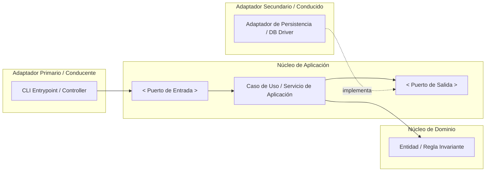

# Arquitectura Hexagonal y Límites de Puertos / Adaptadores

Este documento detalla el flujo formal de inversión de dependencias y los contratos de puertos independientes de cualquier lenguaje de programación.

---

## 1. Topología de Puertos Inbound y Outbound



---

## 2. Inversión del Flujo de Control vs Flujo de Dependencia

El principio central es que el **flujo de ejecución** y el **flujo de dependencias en tiempo de compilación** se cruzan en direcciones opuestas en la frontera de salida:

```
Flujo de Ejecución en Runtime:
  Controlador  -->  Caso de Uso  -->  Puerto Salida (Interfaz)  -->  Driver DB
  
Flujo de Dependencia de Código:
  Controlador  -->  Caso de Uso  <--  [Implementación de Driver DB]
                                  ^
                          (Apunta hacia adentro)
```

### Reglas de Diseño Estricto:
1. **El Caso de Uso define la Interfaz que necesita**: Nunca define el adaptador la interfaz que expone. Si el caso de uso necesita guardar datos, declara `Save(item) -> Result`, no `ExecuteSQLQuery(query)`.
2. **Aislamiento de Errores Técnicos**: Los errores originados en infraestructura (ej. timeout de socket, conexión rechazada de base de datos) deben ser capturados por el adaptador y remapeados a errores de dominio abstractos antes de ser propagados hacia arriba.
3. **Inmutabilidad en la Frontera**: Los datos que cruzan del adaptador al caso de uso deben ser tipos de datos inmutables y planos.
