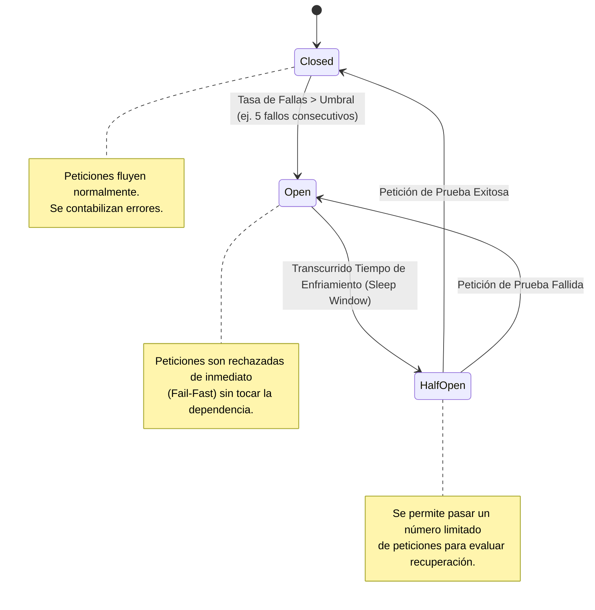

# Patrones Universales de Tolerancia a Fallos y Resiliencia

Este documento define la topología de máquinas de estados y los algoritmos estándar para mitigar fallas en sistemas concurrentes y distribuidos.

---

## 1. Máquina de Estados del Circuit Breaker

El Circuit Breaker previene que un fallo transitorio en una dependencia externa provoque una falla en cascada (*cascading failure*), aislando el componente averiado.



---

## 2. Reintentos con Exponential Backoff y Full Jitter

Cuando una operación falla por causas transitorias (ej. error 503, timeout de red), reintentar de inmediato satura aún más el servidor destino (Tormenta de Reintentos).

### Algoritmo Abstracto:
```
BaseDelay     = 100 milisegundos
MaxDelay      = 5000 milisegundos
Factor        = 2
Attempt       = número de intento actual (1, 2, 3...)

CalculatedDelay = min(MaxDelay, BaseDelay * (Factor ^ Attempt))
SleepDuration   = random_between(0, CalculatedDelay)   <-- Full Jitter aleatorio
```

El agregado de **Jitter aleatorio** dispersa los reintentos en el tiempo, rompiendo la sincronización de múltiples clientes que intentarían reintentar exactamente al mismo milisegundo.

---

## 3. Contrato de Idempotencia mediante Tokens Únicos

Para evitar efectos secundarios duplicados ante reintentos de red:

```
Petición Entrante:
  Header: Idempotency-Key: <UUID-v4>
  Payload: { ... }

Paso 1: Consultar almacén de llaves (Cache in-memory / Almacén rápido).
  SI la llave existe y su estado es "COMPLETED":
    -> Retornar la respuesta guardada de inmediato (sin re-procesar el negocio).
  SI la llave existe y su estado es "IN_PROGRESS":
    -> Retornar 409 Conflict o esperar con timeout.
  SI la llave NO existe:
    -> Registrar la llave con estado "IN_PROGRESS" y TTL (ej. 24 horas).
    -> Ejecutar la transacción de negocio de forma atómica.
    -> Actualizar el estado de la llave a "COMPLETED" con la respuesta final.
```
