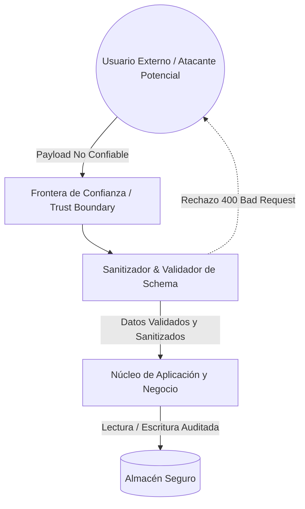

# Taxonomía STRIDE-A y Catálogo de Mitigaciones

Este documento define la taxonomía de modelado de amenazas STRIDE-A (*STRIDE + Abuse Cases*) y sus contramedidas arquitectónicas estándar.

---

## 1. La Matriz STRIDE-A

| Amenaza | Definición del Riesgo | Ejemplo de Escenario Límite | Mitigación Arquitectónica Estándar |
| :--- | :--- | :--- | :--- |
| **S**poofing (Suplantación) | Un atacante se hace pasar por un usuario o servicio legítimo. | Manipulación de identificadores en tokens o headers de red. | Autenticación criptográfica fuerte (JWT firmado con clave asimétrica, mTLS en microservicios). |
| **T**ampering (Alteración) | Modificación maliciosa de datos en tránsito o en reposo. | Alteración de precios o permisos en payloads JSON durante el viaje. | Hashing criptográfico, firmas HMAC, validación de integridad y TLS obligatorio. |
| **R**epudiation (Repudio) | Un autor niega haber ejecutado una acción crítica y no hay prueba. | Un usuario borra un registro y no hay rastro en auditoría. | Logs inmutables de auditoría (*Audit Trail*) append-only con timestamp y correlation ID. |
| **I**nformation Disclosure | Exposición de datos confidenciales a entidades no autorizadas. | Retorno de stack traces con rutas internas y contraseñas en respuestas 500. | Sanitización de errores en adaptadores de frontera; enmascaramiento de PII en logs. |
| **D**enial of Service (DoS) | Saturación deliberada que deja el servicio inoperable. | Envío masivo de payloads gigantes o miles de peticiones por segundo. | Rate Limiting (Token Bucket / Leaky Bucket), límites de tamaño de request y timeouts de socket. |
| **E**levation of Privilege | Un usuario no privilegiado accede a funciones administrativas. | Manipulación de campos de rol en peticiones de actualización de perfil. | Control de acceso basado en roles o atributos (RBAC/ABAC) validado en el núcleo de dominio. |
| **A**buse Cases (Abuso de Negocio)| Uso legal de la API con intención maliciosa o perjudicial. | Creación masiva de cuentas falsas o scraping abusivo de catálogos. | Detección de patrones anómalos, CAPTCHAs en endpoints públicos y throttling adaptativo. |

---

## 2. Flujo de Datos Seguro en Fronteras (Data Flow Diagram - DFD)

### Reglas de la Frontera de Confianza:
1. **Validación Exhaustiva en la Puerta**: Todo dato que cruza la *Trust Boundary* se asume malicioso hasta que supera la validación estricta de schema (tipos, longitudes, rangos y caracteres permitidos).
2. **Principio de Mínimo Privilegio**: Cada componente del sistema debe operar con los permisos mínimos requeridos para cumplir su función, nunca con privilegios globales o de superusuario.
