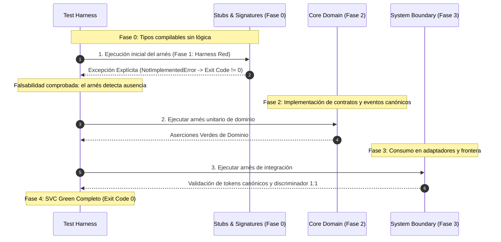

# Guía Técnica: Ciclo de Arnés Desacoplado y Falsabilidad Popperiana

Esta guía especifica el protocolo estricto para estructurar el arnés de pruebas automatizadas y desacoplar los supuestos del implementador mediante la secuencia Verification-First en 5 fases.

---

## 1. Patología a Erradicar: La Tautología de Mocks

```
+-----------------------------------------------------------------------------------+
|                        EL ANTIPATRÓN DE LA TAUTOLOGÍA DE MOCKS                    |
+-----------------------------------------------------------------------------------+
  Implementador escribe código y test en paralelo.
  Diseña dobles o mocks que replican sus propios supuestos no comprobados.
  El test pasa en verde (Green), pero el sistema falla en producción o frontera.
  ---------------------------------------------------------------------------------
  SOLUCIÓN: Desacoplamiento temporal estricto en 5 fases secuenciales.
```

---

## 2. Las 5 Fases de la Secuencia Verification-First



---

## 3. Matriz de Fases y Criterios de Paso

| Fase | Artefactos Producidos | Estado Requerido del Arnés | Acción Prohibida |
| :--- | :--- | :--- | :--- |
| **Fase 0: Stubs** | Firmas de tipos, interfaces, clases | Compilable; ejecución lanza `NotImplemented` | Devolver valores complacientes por defecto (`return null`, `return true`) |
| **Fase 1: Red** | Suites de prueba negativas y reposo | **Falla Inequívoca** (`Exit Code != 0`) | Escribir código de producción para que pase |
| **Fase 2: Core** | Entidades de dominio, lógica de cálculo | Pasan pruebas de lógica pura de dominio | Modificar los tests para acomodarlos al código |
| **Fase 3: Boundary** | Adaptadores de red, endpoints, vistas UI | Pasan pruebas de integración y renderizado | Usar strings ambiguos o colapsar eventos |
| **Fase 4: SVC** | Suite completa automatizada | **Exit Code 0 Determinista** | Solicitar al usuario que pruebe manualmente |

---

## 4. Escenario Canónico de Aserción Falsable

```gherkin
GIVEN una nueva interfaz de servicio con stubs en Fase 0
WHEN el arnés de pruebas invoca el método antes de implementar el core
THEN la invocación produce una excepción de tipo NotImplementedError
AND el proceso del arnés termina con código de salida distinto de cero
```
