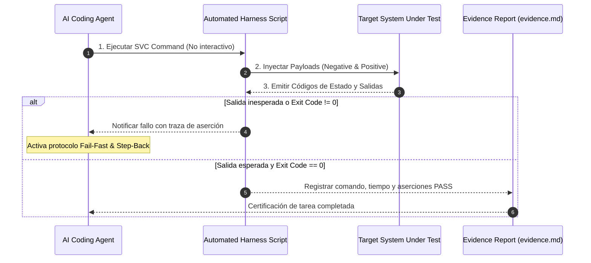

# System Verification Contract (SVC) & Boundaries

El SVC formaliza cómo un agente autónomo verifica un sistema de software sin intervención humana, desacoplando el arnés del stack tecnológico subyacente.

---

## 1. Taxonomía de Interfaces de Frontera (Boundaries)

El arnés observa el comportamiento del software a través de cuatro fronteras estándar:

| Tipo de Frontera | Punto de Observación Primario | Condición Determinista de Éxito | Condición de Fallo Detectable |
| :--- | :--- | :--- | :--- |
| **CLI / Scripts** | Standard Streams (`stdout`, `stderr`) y Process Exit Code. | `Exit Code == 0` con aserciones esperadas en `stdout`. | `Exit Code != 0` o mensajes de error en `stderr`. |
| **HTTP / REST API** | Códigos de estado HTTP, Headers y Payloads JSON. | Códigos `2xx` con schemas validados y latencia bajo umbral. | Códigos `4xx` (en prueba negativa) o `5xx` (error de servidor). |
| **Eventos / IPC** | Colas de mensajes, tópicos, tuberías (*pipes*) y sockets. | Recepción de mensaje de ACK o evento con correlación ID. | Timeout de espera expirado, mensaje en Dead Letter Queue. |
| **UI Web / DOM** | Árbol DOM, accesibilidad de elementos y consola del navegador. | Selectores semánticos visibles, cero errores en consola de JS. | Excepciones no capturadas en consola, elementos ausentes en DOM. |

---

## 2. Diagrama de Ejecución Autónoma del SVC



---

## 3. Protocolo de Aserciones Cuantitativas Gherkin

Toda prueba automatizada que implemente el agente debe responder a criterios cuantitativos exactos:

```gherkin
Scenario: Validación de umbral de tiempo y respuesta determinista
  GIVEN el servicio inicializado en un entorno de pruebas aislado
  WHEN se envía una solicitud válida con una carga de prueba estándar
  THEN el código de estado de respuesta debe ser 200
  AND el tiempo total de procesamiento debe ser inferior a 250 milisegundos
  AND el cuerpo de la respuesta debe contener el estado "SUCCESS" y el identificador de correlación
```

Prohibido escribir aserciones cualitativas vagas como `"el sistema debe responder rápido"` o `"los datos deben ser correctos"`.
