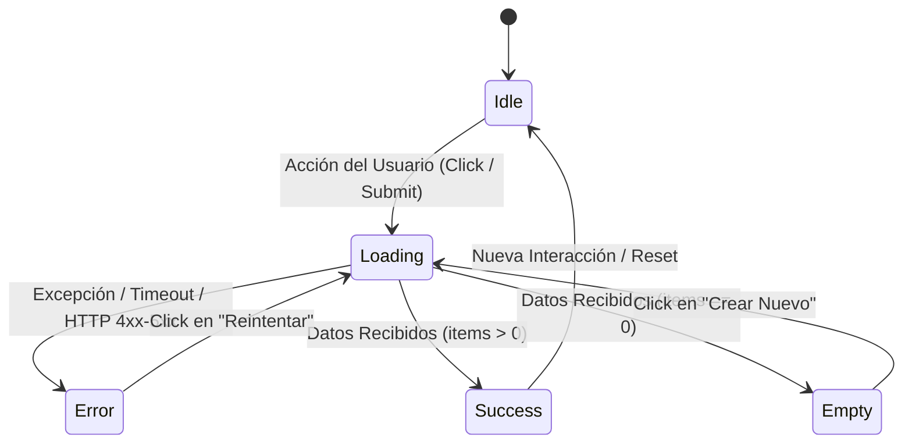

# Ciclo de Vida y Transiciones de los 5 Estados de Interfaz

Este documento define el comportamiento exhaustivo que todo componente interactivo debe implementar a lo largo de sus cinco estados de existencia.

---

## 1. Especificación Detallada de Estados

### Estado 1: IDLE (Reposo / Listo)
* **Propósito**: Estado base donde el componente espera la interacción del usuario.
* **Comportamiento**:
  - Elementos interactivos habilitados.
  - Cursors apropiados (`cursor: pointer` en botones/enlaces).
  - Indicadores de foco accesibles al navegar con teclado.

### Estado 2: LOADING (En Procesamiento)
* **Propósito**: Comunicar inmediatamente al usuario que su acción está siendo procesada.
* **Comportamiento**:
  - Deshabilitar el botón/disparador para prevenir múltiples envíos concurrentes (*double submit*).
  - Exhibir indicador visual: spinner suave, skeleton screens o barra de progreso.
  - Atributo de accesibilidad: `aria-busy="true"` en el contenedor contenedor del componente.

### Estado 3: ERROR (Falla o Rechazo)
* **Propósito**: Informar de forma no destructiva qué ocurrió y proveer una vía de recuperación.
* **Comportamiento**:
  - Mostrar mensaje de error legible por humanos, explicando la causa (ej. "No pudimos conectar con el servidor. Revisa tu conexión.").
  - Proveer botón de reintento directo ("Reintentar operación").
  - Atributo de accesibilidad: `role="alert"` o `aria-live="assertive"`.

### Estado 4: EMPTY (Sin Registros / Colección Vacía)
* **Propósito**: Evitar la sensación de pantalla rota cuando una consulta retorna cero elementos.
* **Comportamiento**:
  - Ilustración o ícono contextual representativo.
  - Mensaje explicativo claro (ej. "Aún no tienes tareas creadas").
  - Botón de llamada a la acción primario (*Call to Action*): "Crear tu primera tarea".

### Estado 5: SUCCESS (Completado / Con Datos)
* **Propósito**: Renderizar los datos o confirmar la mutación exitosa.
* **Comportamiento**:
  - Transición suave (fade-in o slide-in sutil, 150-200ms).
  - Feedback efímero en mutaciones (toast o banner de confirmación) con opción de descartar.

---

## 2. Diagrama de Transición de Estados (Mermaid)

