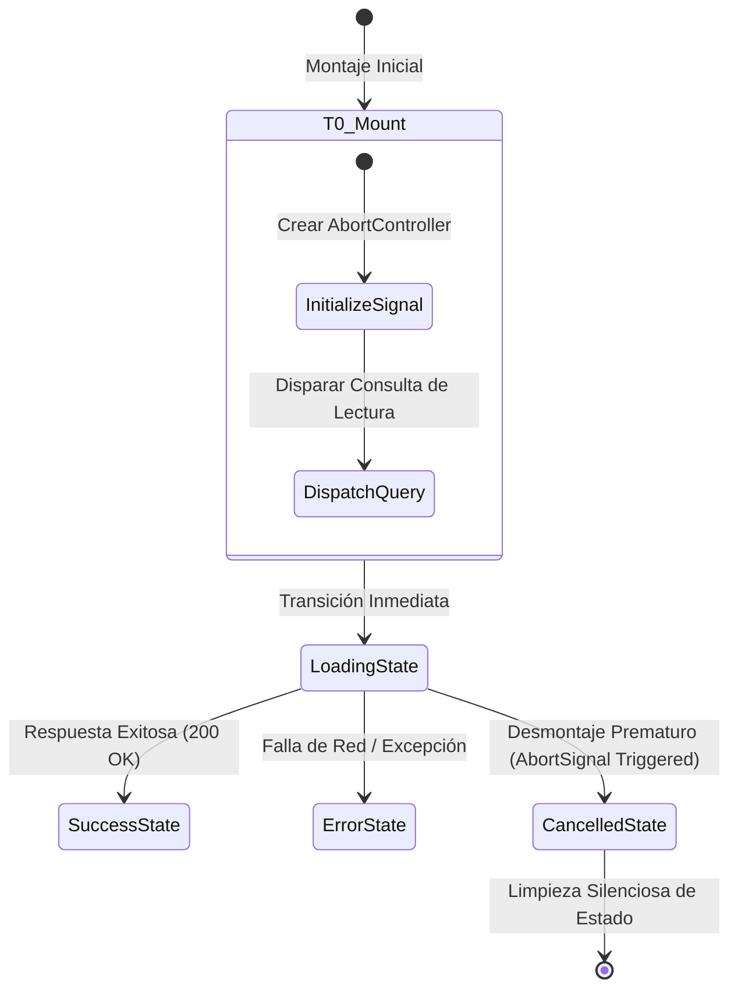

# Guía Técnica: Invariantes de Reposo en T=0 y Ciclo de Vida

Esta guía establece el protocolo formal para prevenir efectos secundarios prematuros en el montaje de componentes y clientes de datos.

---

## 1. Taxonomía de Componentes y Reglas en T=0

```
+-----------------------------------------------------------------------------------+
|               TAXONOMÍA DE COMPONENTES FRENTE A LA INVARIANTE T=0                 |
+-----------------------------------------------------------------------------------+
  TIPO A: Componentes Input-Driven (Formularios, Acciones, Modales)
          * Estado Inicial: IDLE Estricto.
          * Invariante de Red: CERO peticiones automáticas.
          * Invariante de UI: CERO banners o textos de error activos.
  ---------------------------------------------------------------------------------
  TIPO B: Componentes Read-Driven (Vistas, Dashboards, Widgets)
          * Estado Inicial: Transición inmediata a LOADING (Query inicial).
          * Invariante de Red: CERO mutaciones (POST/PUT/DELETE) automáticas.
          * Invariante de UI: CERO banners de error previos a la respuesta.
          * Ciclo de Vida: Mecanismo de cancelación (AbortController) OBLIGATORIO.
```

---

## 2. Máquina de Estados y Cancelación Determinista

En componentes de lectura que disparan peticiones al montarse, el ciclo de vida debe contemplar el desmontaje prematuro para evitar condiciones de carrera o fugas de memoria:



---

## 3. Escenarios Canónicos de Verificación Gherkin

### Escenario 1: Montaje Limpio en Componente Orientado a Entrada
```gherkin
GIVEN que el componente de formulario se inicializa en un entorno limpio sin datos
WHEN transcurre el tiempo T=0 sin interacción del usuario
THEN no se emite ninguna petición de mutación a la red
AND el contenedor con data-testid="error-container" no existe o permanece vacío
```

### Escenario 2: Montaje Limpio en Componente de Lectura con Desmontaje Rápido
```gherkin
GIVEN un componente contenedor que consulta datos al montarse
WHEN el componente es desmontado antes de recibir respuesta del backend
THEN la señal de cancelación emite un evento de aborto limpio
AND no se produce ninguna actualización de estado sobre la instancia desmontada
```

---

## 4. Matriz de Auditoría Anti-Efectos Prematuros

| Elemento Observable | Estado Requerido en T=0 (Input) | Estado Requerido en T=0 (Read-Driven) |
| :--- | :--- | :--- |
| **Peticiones I/O** | 0 llamadas | 1 llamada de lectura (GET/Query) |
| **Indicador de Carga** | Inactivo / Oculto | Activo (`aria-busy="true"`, skeleton) |
| **Contenedores de Error** | Inactivos / Vacíos | Inactivos / Vacíos |
| **Campos de Entrada** | Valores por defecto limpios | N/A |
| **Botones de Envío** | Habilitados o Deshabilitados sin error | N/A |
| **Señal de Aborto** | No requerida | Instanciada y vinculada al ciclo |
