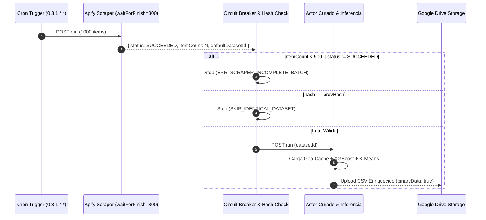

# Technical Design: Hermetic Actor Portability & n8n Workflows Semantic Invariants

## Context
Ver `proposal.md` y `specs/apify-inference-pipeline/spec.md`.
La auditoría arquitectónica post-implementación identificó filtraciones de contexto del monorepo (`etl/` y `producto2/`) dentro del Dockerfile del Actor de Apify, cadencias cron erróneas en n8n (`months` mensual en lugar de anual `0 4 1 3 *`), omisión de banderas de transferencia binaria en los nodos de Google Drive (`binaryData: true`), y riesgo de falsos positivos en el Circuit Breaker por timeout prematuro del scraper (`waitForFinish=120` vs 300).

Este diseño define la estrategia de refactorización hermética del Actor y el endurecimiento semántico de los flujos de n8n bajo gobernanza Tier M (YAGNI estricto, sin dependencias externas adicionales, verificación determinista autónoma).

## Goals / Non-Goals

**Goals:**
- Desacoplar completamente el Actor dentro de `actor/src/`, abstrayendo la limpieza NLP tabular en `actor/src/nlp_parser.py` y la inferencia/clasificación en `actor/src/scoring.py`.
- Garantizar que el Actor pase los tests de aislamiento en un entorno limpio sin acceso a `etl` o `producto2` en `sys.path`.
- Corregir el Cron anual en n8n a la expresión canónica `0 4 1 3 *` y añadir compuerta de idempotencia contra la API CKAN (`metadata_modified`).
- Corregir el timeout del scraper en n8n a `waitForFinish=300`, validar `status === "SUCCEEDED"` y habilitar `binaryData: true` en todas las subidas a Google Drive.

**Non-Goals:**
- Modificar los modelos serializados (`producto2/artifacts/*.joblib`) o alterar los coeficientes matemáticos de predicción.
- Crear una interfaz gráfica web (diferida a ramas posteriores).
- Migrar el almacenamiento a un proveedor distinto de Google Drive.

## Decisions

### 1. Extracción Modular vs Duplicación de Código
- **Decisión:** Extraer funciones puras de procesamiento de texto y reglas de scoring a `actor/src/nlp_parser.py` y `actor/src/scoring.py`. En `actor/src/pipeline.py` se importan exclusivamente estos módulos locales.
- **Alternativas consideradas:**
  - *Instalar el monorepo como paquete pip (`pip install -e .`) dentro del contenedor:* Descartado. Viola el principio de contexto mínimo de Docker y obliga a transferir código no relacionado (notebooks, tests, documentación) a la imagen de Apify.
  - *Symlinks dentro de `actor/`:* Descartado. Docker no resuelve symlinks que apunten fuera del build context.

### 2. Invocación Dual CLI / Apify en `main.py`
- **Decisión:** Activar `_run_apify_mode()` únicamente si la variable de entorno `APIFY_IS_AT_HOME` está presente o si se pasa explícitamente `--apify`. Si no se proveen argumentos ni variables de entorno, imprimir ayuda y salir con código 0.
- **Alternativas consideradas:**
  - *Detectar presencia del paquete `apify`:* Descartado. En entornos locales de desarrollo donde el paquete esté instalado, ejecutar `main.py` sin argumentos disparaba inadvertidamente el runtime de Apify buscando storage local inexistente.

### 3. Idempotencia y Cron Anual en n8n
- **Decisión:** Utilizar `"field": "cronExpression"` con `"expression": "0 4 1 3 *"` en `workflow_anual_auditoria_gcba.json`. Evaluar `metadata_modified` contra `$getWorkflowStaticData('global').lastModified` mediante un nodo `IF`. Si no hay cambios, emitir el token canónico `SKIP_NO_ANNUAL_UPDATE` y no invocar la descarga ni subida a Drive.
- **Alternativas consideradas:**
  - *Descargar siempre y comparar hashes:* Descartado. Consume ancho de banda y cuota de Drive innecesariamente. La API CKAN provee metadatos livianos para esta comprobación.

### 4. Robustez de Transferencia Binaria en Google Drive
- **Decisión:** Configurar explícitamente `"binaryData": true` y `"binaryPropertyName": "data"` en todos los nodos de Google Drive de n8n, acompañados de la descarga con `responseFormat: "file"`.
- **Alternativas consideradas:**
  - *Mapear payload JSON como texto:* Descartado. Provocaba archivos vacíos o corruptos al guardar blobs binarios o multipart.

## Living Architecture & Workflow Sequence

## Principio de No-Colapso Semántico (Fronteras y Transiciones)

| Frontera / Evento | Causa Raíz | Estado / Discriminador Causal 1:1 | Acción Compensatoria |
|---|---|---|---|
| Scraper Zonaprop | Timeout HTTP (>300s) o fallo del actor scraper | `{ status: "FAILED", razon: "ERR_SCRAPER_TIMEOUT_OR_CRASH" }` | Abortar ejecución; preservar dataset previo en Drive |
| Scraper Zonaprop | Bloqueo anti-bot o cambio de layout (< 500 items) | `{ status: "ABORTED", razon: "ERR_SCRAPER_INCOMPLETE_BATCH" }` | Emitir alerta; no invocar Actor de inferencia |
| Scraper Zonaprop | Contenido sin novedades (mismo hash SHA-256) | `{ status: "SKIPPED", razon: "SKIP_IDENTICAL_DATASET" }` | Omitir inferencia; no sobreescribir Drive |
| Actor Inferencia | Falla de inferencia o modelo corrupto | `{ status: "ERROR", razon: "ERR_INFERENCE_PIPELINE_FAILED" }` | Registrar error en n8n; no persistir archivo corrupto |
| CKAN API GCBA | Metadatos idénticos a última auditoría | `{ status: "SKIPPED", razon: "SKIP_NO_ANNUAL_UPDATE" }` | Detener flujo anual; no descargar ni subir a Drive |
| CKAN API GCBA | Recurso actualizado por el GCBA | `{ status: "SUCCESS", razon: "EVENT_GCBA_DATA_UPDATED" }` | Descargar archivo binario y resguardar en Raw Anual |

## Protocolo Grill-Me Exhaustivo (14 Vectores de Falla Crítica)

1. **Aislamiento de Módulos (Container Context Leak):** Si `actor/src/pipeline.py` intenta importar `etl` en Apify, crasheará. *Mitigación:* Se extraen todas las dependencias a `actor/src/nlp_parser.py` y `actor/src/scoring.py`. Verificado mediante test hermético con `PYTHONPATH=""`.
2. **Cron Trigger Anual Invocado Mensualmente:** Si se usa `"field": "months"`, n8n dispara el 1 de cada mes. *Mitigación:* Fijado a expresión cron `"0 4 1 3 *"`.
3. **Descarga Redundante Anual:** Sin compuerta de idempotencia, se satura el almacenamiento con datos duplicados. *Mitigación:* Comparación de `metadata_modified` con `$getWorkflowStaticData()`.
4. **Subida Vacía a Google Drive:** Los nodos n8n omitían `binaryData: true`. *Mitigación:* Configuración explícita de `binaryData: true` y `binaryPropertyName: "data"`.
5. **Timeout Asíncrono del Scraper:** `waitForFinish=120` retornaba HTTP 201 `RUNNING` en lotes grandes, falseando `itemCount: 0`. *Mitigación:* Extendido a `waitForFinish=300` con verificación estricta de `status === "SUCCEEDED"`.
6. **Formato CSV con Metadatos Apify Sucios:** Descarga de dataset sin filtrar columnas del sistema. *Mitigación:* Adición del parámetro `&clean=true` en la URL de descarga CSV.
7. **Ausencia de Coordenadas Geográficas:** Propiedades con lat/lon nulas o fuera de CABA. *Mitigación:* Imputación al centroide de CABA y etiquetado en `tag_auditoria` con `AUDIT_COORD_IMPUTED`.
8. **Ausencia de Precios o Moneda Invalida:** Publicaciones en USD o sin precio. *Mitigación:* Conversión determinista a ARS o imputación de mediana con tag `AUDIT_PRICE_IMPUTED`.
9. **Corrupción de Geo-Caché en Frío:** Si los archivos parquet o joblib no existen en el contenedor. *Mitigación:* Verificación estricta de existencia; fallo controlado y advertencia si falta algún archivo de referencia.
10. **Límite de Memoria RAM en Apify (Memory Bloat):** Si el cruce geoespacial carga CSVs crudos de 70 MB. *Mitigación:* Geo-Caché pre-optimizado en GeoParquet (26 MB) y BallTrees indexados en memoria, consumo < 400 MB RAM.
11. **Divergencia de Esquema de Salida:** Alteración inadvertida de nombres de columnas. *Mitigación:* Validación estricta de las 10 features requeridas y columnas de scoring corporativo.
12. **Incompatibilidad de Tipos Numéricos en XGBoost:** Valores `None` o strings en columnas de inferencia. *Mitigación:* Casting explícito `.astype(float)` e imputación defensiva de medianas previa a la predicción.
13. **Concurrencia de Ejecución n8n:** Dos ejecuciones simultáneas sobrescribiendo el mismo archivo. *Mitigación:* Nombres de archivo versionados con timestamp/año-mes (`$now.format('yyyy_MM')`).
14. **Incompatibilidad de Dependencias en Docker:** Desajustes entre versiones locales y contenedor. *Mitigación:* Dockerfile congelado con dependencias exactas y test de regresión automatizado.

## Análisis de Impacto
- **Memoria:** Consumo máximo del Actor < 450 MB RAM durante el cruce de 1,000 registros con el BallTree de delitos y GeoParquet de ruido.
- **Latencia:** Procesamiento de 1,000 propiedades estimado en ~2.8 segundos dentro del contenedor.
- **Concurrencia:** Ejecución mensual batch atómica; no requiere workers concurrentes.
- **Observabilidad:** Emisión de tokens canónicos (`ERR_SCRAPER_INCOMPLETE_BATCH`, `SKIP_IDENTICAL_DATASET`, `SKIP_NO_ANNUAL_UPDATE`, `EVENT_GCBA_DATA_UPDATED`) legibles en logs de n8n.

## Risks / Trade-offs

- **[Riesgo: Duplicación de lógica regex entre `etl/` y `actor/src/nlp_parser.py`]**  
  → *Mitigación:* Mantener `actor/src/` como el paquete canónico autónomo; unificar pruebas de regresión que validen paridad de salida exacta entre ambas implementaciones.
- **[Riesgo: Disponibilidad de API CKAN de GCBA]**  
  → *Mitigación:* Si la API CKAN responde con error 5xx, el flujo anual captura el error en n8n sin degradar el pipeline mensual de Zonaprop.
