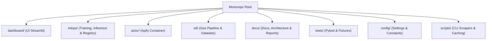

## Purpose
Define los estándares normativos de higiene, seguridad de credenciales y topología de directorios para el monorepo Observatorio Inmobiliario CABA.

## Architecture & Layout

## ADDED Requirements

### Requirement: Documentation Centralization
The system MUST consolidate all architecture guides, business questions, and technical specifications into the `docs/` hierarchy, removing loose `.md` and `.txt` files from the root.

#### Scenario: Documentation structure inspection
- **WHEN** un desarrollador o agente audita la estructura del directorio `docs/`
- **THEN** los documentos de arquitectura residen en `docs/architecture/`, las preguntas de negocio en `docs/business_questions.md`, la selección de features en `docs/feature_selection.md` y la raíz del proyecto no contiene archivos `.txt` ni `.md` sueltos excepto `README.md`.

### Requirement: Credential Quarantine in Scripts
The system MUST ensure that all utility scripts in `scripts/` consume API credentials exclusively from environment variables and never store plaintext tokens in the repository.

#### Scenario: Apify scraper script inspection
- **WHEN** se inspecciona el script `scripts/fetch_apify_raw.py`
- **THEN** no contiene tokens en texto plano y lee `APIFY_TOKEN` desde `os.environ`, emitiendo una advertencia controlada si la variable no está configurada.

### Requirement: Test Fixture Isolation
The system MUST relocate all sample datasets and mock payloads to `tests/fixtures/`, removing misleading root data folders.

#### Scenario: Root directory inspection
- **WHEN** se lista el contenido de la raíz del monorepo
- **THEN** no existe ningún directorio `data/` en la raíz y los archivos de muestra `curated_sample_output.csv` y `sample_raw_listings.json` residen en `tests/fixtures/`.

### Requirement: Backward Compatible Module Layout
The configuration module `config/settings.py` MUST resolve paths for MLOps and ETL outputs while maintaining transparent backward compatibility for all existing test suites.

#### Scenario: Running full regression test suite
- **WHEN** se ejecuta el comando `pytest` desde la raíz del proyecto
- **THEN** la totalidad de las pruebas unitarias y de integración pasan con código de salida 0 (Exit Code 0).

## Test Plan & Resilience Strategy
- **Verificación de Seguridad**: Grep estático para asegurar que ningún archivo contenga tokens con prefijo `apify_api_`.
- **Verificación de Regresión**: Ejecución de `pytest` validando que tanto los tests de ML como los del Dashboard se ejecuten sin fallos de importación.
