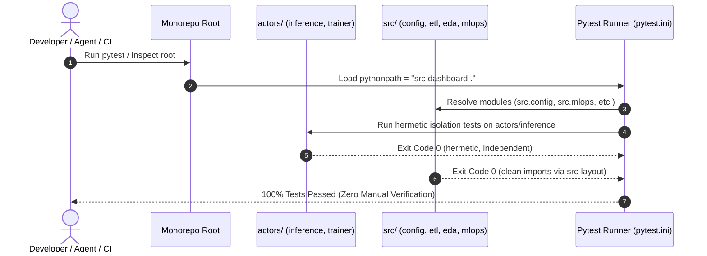

# Delta Spec: monorepo-structure

## MODIFIED Requirements

### Requirement: Backward Compatible Module Layout
The configuration module `src/config/settings.py` MUST resolve paths for MLOps, ETL, datasets and actor caches using `Path(__file__).resolve().parents[2]` as `BASE_DIR`, and `pytest.ini` MUST configure `pythonpath = src dashboard .` maintaining transparent compatibility for existing tests and scripts.

#### Scenario: Running full regression test suite
- **GIVEN** la raíz del monorepo configurada con `pythonpath = src dashboard .` en `pytest.ini`
- **WHEN** se ejecuta el comando `pytest` desde la raíz del proyecto
- **THEN** la totalidad de las pruebas unitarias y de integración pasan con código de salida 0 (`Exit Code 0`) y ningún test reporta error de importación de `config`, `etl`, `eda` o `mlops`.

## ADDED Requirements

### Requirement: Consolidated Actor Layout
The system MUST consolidate all Apify actor containers inside the `actors/` namespace (specifically `actors/inference/` and `actors/trainer/`), eliminating separate `actor/` and `trainer/` root directories.

#### Scenario: Inspect actors directory structure
- **GIVEN** el repositorio tras la migración arquitectónica
- **WHEN** un agente o auditor lista las carpetas en la raíz del proyecto
- **THEN** ni `actor/` ni `trainer/` existen en la raíz, y `actors/inference/Dockerfile` y `actors/trainer/Dockerfile` existen y son ejecutables de forma autónoma.

### Requirement: Consolidated Core Analytics Layout
The system MUST consolidate all core analytical modules, data pipelines and MLOps components into `src/` (`src/config/`, `src/etl/`, `src/eda/`, `src/mlops/`), and MUST completely eliminate the legacy compatibility directory `producto2/`.

#### Scenario: Inspect src hierarchy and legacy shims
- **GIVEN** la raíz del monorepo auditada
- **WHEN** se verifica la presencia de componentes de machine learning y datos
- **THEN** el directorio `producto2/` no existe en git ni en el sistema de archivos, y los artefactos de modelos residen en `src/mlops/artifacts/` y las figuras en `src/mlops/figures/`.

### Requirement: Isolated Notebooks Directory
The system MUST relocate the master pipeline notebook `pipeline_observatorio_caba.ipynb` into `notebooks/`, ensuring zero loose `.ipynb` files exist in the root directory.

#### Scenario: Inspect root directory for loose notebooks
- **GIVEN** la raíz del monorepo
- **WHEN** se buscan archivos con extensión `.ipynb` en la raíz mediante `ls *.ipynb`
- **THEN** no existe ningún archivo `.ipynb` en la raíz del monorepo y `pipeline_observatorio_caba.ipynb` existe dentro de `notebooks/`.

## Test Plan & Resilience Strategy
- **Verificación Estática de Raíz**: Validación determinista mediante `git ls-files` comprobando la ausencia de `actor/`, `trainer/`, `producto2/`, `config/`, `etl/`, `eda/`, `mlops/` y `*.ipynb` en la raíz.
- **Verificación de Aislamiento Hermético**: Ejecución de `test_actor_hermetic_isolation` en `tests/test_apify_actor.py` apuntando a `actors.inference.src.pipeline`.
- **Verificación de Regresión Completa**: Ejecución de `pytest` validando que los 70 tests pasen con Exit Code 0.
