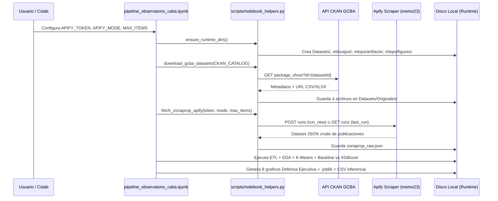

## Purpose

Esta capacidad especifica el comportamiento observable del Notebook Maestro End-to-End (`pipeline_observatorio_caba.ipynb`), su capa auxiliar de ingesta y evaluación (`scripts/notebook_helpers.py`) y la higiene mínima portable del repositorio (exclusión de `Datasets/` y `etl/output/` de git, reemplazo de notebooks legados y compatibilidad de la suite de pruebas en clones limpios).

## Test Plan & Resilience Strategy

### Estrategia Negative-Path First

Antes de validar el camino feliz, la suite de pruebas deterministas (`tests/test_end_to_end_notebook.py` y `tests/test_etl_and_eda.py`) debe verificar el rechazo controlado y tokens canónicos de error en los siguientes escenarios de fallo:

1. **Ausencia de credencial Apify:** ejecución sin `APIFY_TOKEN` debe emitir exactamente `ERR_MISSING_APIFY_TOKEN` y detener la ingesta sin realizar llamadas HTTP.
2. **Modo Apify inválido:** cualquier valor de `APIFY_MODE` distinto de `"last_run"` o `"run_new"` debe emitir `ERR_INVALID_APIFY_MODE`.
3. **Fallo HTTP o catálogo vacío en CKAN GCBA:** timeout, HTTP >= 400 o lista vacía de recursos debe emitir `ERR_GCBA_DOWNLOAD`.
4. **Esquema incompatible en archivo GCBA descargado:** archivo CSV/XLSX sin las columnas geográficas/temáticas mínimas esperadas debe emitir `ERR_GCBA_SCHEMA`.
5. **Fallo o dataset vacío desde `memo23~zonaprop-scraper`:** respuesta HTTP != 200 o lista de ítems con longitud `< 1` debe emitir `ERR_APIFY_SCRAPER_FAILED`.
6. **Regresión de modelo en evaluación:** si el modelo candidato obtiene $R^2$ inferior al baseline `DummyRegressor` o menor al umbral configurado, debe emitir `ERR_METRIC_REGRESSION`.
7. **Repositorio limpio sin `Datasets/` ni `etl/output/`:** `pytest` completo debe finalizar con `Exit Code 0` omitiendo (`skipped`) únicamente los tests de integración que requieren datos generados en runtime.

### Diagrama de Secuencia (Tier M)

## ADDED Requirements

### Requirement: Creación dinámica de directorios y portabilidad del repositorio

El repositorio versionado en git SHALL excluir las carpetas `Datasets/` y `etl/output/` y SHALL eliminar los notebooks legados (`etl/etl_pipeline.ipynb`, `eda/eda_phase2.ipynb`, `mlops/inference.ipynb`). El Notebook Maestro SHALL crear automáticamente todas las carpetas de trabajo requeridas al iniciar su ejecución.

#### Scenario: Repositorio limpio en git
- **GIVEN** un clon limpio del repositorio en la rama de trabajo
- **WHEN** se ejecuta `git ls-files Datasets/ etl/output/ etl/etl_pipeline.ipynb eda/eda_phase2.ipynb mlops/inference.ipynb`
- **THEN** la salida estándar tiene exactamente `0` líneas
- **AND** `.gitignore` contiene reglas explícitas para `Datasets/` y `etl/output/`
- **AND** `mlops/artifacts/` y `actor/reference_geo/` permanecen presentes en el repositorio.

#### Scenario: Inicialización dinámica de carpetas en runtime
- **GIVEN** un directorio raíz temporal sin carpetas `Datasets/` ni `etl/output/`
- **WHEN** se invoca la rutina de inicialización del entorno del notebook
- **THEN** existen en disco exactamente los directorios `Datasets/Originales`, `Datasets/Curados`, `etl/output`, `mlops/artifacts` y `mlops/figures`.

#### Scenario: Suite de pruebas en entorno sin datasets generados
- **GIVEN** un entorno donde `Datasets/Curados/` y `etl/output/` no existen en disco
- **WHEN** se ejecuta `pytest`
- **THEN** el proceso finaliza con código de salida exactamente `0`
- **AND** `test_datasets_curados_folder_has_5_valid_csvs` reporta estado `SKIPPED` en lugar de `FAILED`.

### Requirement: Ingesta Live defensiva desde CKAN GCBA y Apify Scraper

El sistema SHALL descargar los 4 datasets oficiales de GCBA (`delitos`, `bocas-subte`, `mapa-ruido`, `establecimientos-educativos`) desde la CKAN API oficial y los avisos de Zonaprop exclusivamente mediante el actor scraper de terceros `memo23~zonaprop-scraper`, sin invocar actores custom de inferencia ni entrenamiento.

#### Scenario: Rechazo por ausencia de APIFY_TOKEN (Negative Path)
- **GIVEN** que la variable `APIFY_TOKEN` está vacía o no definida
- **WHEN** se intenta descargar publicaciones de Zonaprop
- **THEN** la función lanza una excepción cuyo mensaje contiene el token canónico `ERR_MISSING_APIFY_TOKEN`
- **AND** se realizan exactamente `0` solicitudes HTTP a `api.apify.com`.

#### Scenario: Rechazo por APIFY_MODE inválido (Negative Path)
- **GIVEN** un `APIFY_TOKEN` no vacío y `APIFY_MODE = "invalid_mode"`
- **WHEN** se intenta descargar publicaciones de Zonaprop
- **THEN** la función lanza una excepción cuyo mensaje contiene el token canónico `ERR_INVALID_APIFY_MODE`.

#### Scenario: Fallo de descarga o esquema en CKAN GCBA (Negative Path)
- **GIVEN** una respuesta HTTP `503` o un paquete CKAN sin recursos `.csv`/`.xlsx` válidos
- **WHEN** se intenta descargar el catálogo de GCBA
- **THEN** la función lanza una excepción cuyo mensaje contiene el token canónico `ERR_GCBA_DOWNLOAD` (fallo de red/recursos) o `ERR_GCBA_SCHEMA` (archivo sin columnas requeridas).

#### Scenario: Descarga exitosa en modo last_run y run_new
- **GIVEN** un `APIFY_TOKEN` válido y respuestas HTTP `200` simuladas de `memo23~zonaprop-scraper` con `>= 1` ítems
- **WHEN** se ejecuta la ingesta con `APIFY_MODE = "last_run"` o `APIFY_MODE = "run_new"`
- **THEN** se persiste un archivo JSON válido con longitud `>= 1` y se retorna metadata con `status = "OK"` y `count >= 1`.

### Requirement: Evaluación comparativa y 8 gráficos de Defensa Ejecutiva

El Notebook Maestro SHALL entrenar K-Means y XGBoost (junto con baselines `DummyRegressor`, `Ridge` y `RandomForestRegressor`), validar métricas en holdout/CV y generar los 8 bloques gráficos definidos para la Defensa Ejecutiva.

#### Scenario: Comparativa contra baseline y guardrail de regresión
- **GIVEN** un dataset curado válido con `>= 50` filas y las 10 features seleccionadas
- **WHEN** se ejecuta la evaluación comparativa de modelos
- **THEN** la tabla de resultados contiene exactamente las 4 filas de modelos (`DummyRegressor`, `Ridge`, `RandomForestRegressor`, `XGBoost`) con métricas numéricas finitas `MAE_ars`, `RMSE_ars`, `MAPE_pct` y `R2`
- **AND** si `XGBoost` no supera el umbral de regresión definido respecto al baseline, se emite el token canónico `ERR_METRIC_REGRESSION`.

#### Scenario: Cobertura verificable de los 8 gráficos de Defensa Ejecutiva
- **GIVEN** el archivo `pipeline_observatorio_caba.ipynb` en la raíz del repositorio
- **WHEN** se inspeccionan todas sus celdas mediante análisis estático AST
- **THEN** el 100% de las celdas de código compilan sin `SyntaxError`
- **AND** el notebook contiene generación explícita para los 8 bloques gráficos: (1) Distribución Target + `log1p`, (2) Mapa Scatter CABA (`lon`/`lat`), (3) K-Means Elbow + Silhouette + Heatmap de Centroides, (4) Comparativa Baseline vs. Modelos, (5) Curva de Aprendizaje Train vs. CV, (6) Predicho vs. Real + Residuos, (7) Auditoría de Error por Barrio y Cuartil de Precio, y (8) SHAP Beeswarm + Waterfall (Oportunidad vs. Sobreprecio).

### Requirement: Documentación y comentarios didácticos obligatorios en el Notebook Maestro

El Notebook Maestro SHALL estar exhaustivamente comentado y documentado para su lectura en la defensa del Capstone y por cualquier tercero que clone el proyecto.

#### Scenario: Cobertura de narrativa Markdown y comentarios inline en código
- **GIVEN** el archivo `pipeline_observatorio_caba.ipynb` en la raíz del repositorio
- **WHEN** se ejecuta la auditoría estructural del notebook en `tests/test_end_to_end_notebook.py`
- **THEN** existen al menos `7` celdas Markdown correspondientes a los Pasos 0 a 6 con encabezados jerárquicos (`#` / `##`) y explicación de objetivo e interpretación
- **AND** el 100% de las celdas de código contienen al menos `2` líneas de comentarios inline (`#`) explicando la lógica implementada
- **AND** ningún archivo del notebook contiene secretos hardcodeados (`apify_api_`).
