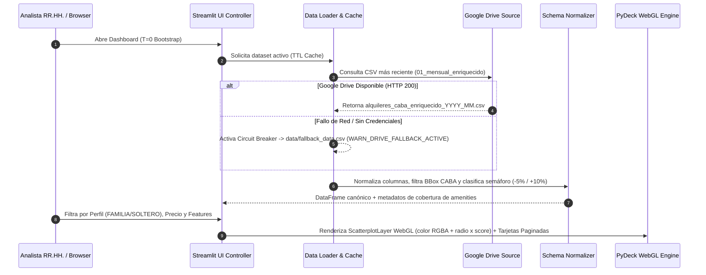

## Purpose
Provee el contrato de comportamiento del dashboard geoespacial interactivo para la exploración de propiedades de alquiler en CABA, garantizando la ingesta resiliente del archivo mensual más reciente desde Google Drive con conmutación por fallo local, la normalización de esquemas heterogéneos, el filtrado multi-atributo de baja latencia y la visualización cartográfica escalable codificada por perfil corporativo (`FAMILIA` vs. `SOLTERO_EJECUTIVO`) y semáforo de precios.

## Visual Interaction Flow (Tier M)

## Test Plan & Resilience Strategy

La verificación sigue una estrategia **Negative-Path First** y **Zero Manual Testing**:
1. **Pruebas Negativas de Frontera de Datos (Unit/Integration)**:
   - Simulacro de caída, timeout o ausencia de credenciales de Google Drive verificando transición determinista a `WARN_DRIVE_FALLBACK_ACTIVE` sin excepción no controlada.
   - Inyección de registros con coordenadas nulas, `(0, 0)` o fuera del polígono de CABA verificando descarte con token `AUDIT_OUT_OF_BOUNDS_DROPPED`.
   - Inyección de CSV con esquema reducido de Google Drive (29 columnas sin booleanos `has_parrilla`, `has_pileta`, etc.) verificando degradación elegante con token `INFO_GRANULAR_AMENITIES_UNAVAILABLE`.
   - Inyección de CSV corrupto sin columnas mínimas obligatorias verificando bloqueo controlado con código `ERR_SCHEMA_MISSING_REQUIRED_COLUMNS`.
2. **Pruebas de Escalabilidad y Precisión de Reglas de Negocio**:
   - Benchmark sintético de `10.000` y `50.000` registros verificando que la normalización y filtrado vectorizado completen en `< 50 ms` y `< 150 ms` respectivamente.
   - Verificación exacta de fronteras del semáforo (`<= -5.0%` -> `BAJO_PRECIO`, `-5.0% < x <= 10.0%` -> `PRECIO_JUSTO`, `> 10.0%` -> `SOBREPRECIO`).
3. **Verificación Autónoma E2E en Navegador (`browser_subagent`)**:
   - Inspección automatizada de los 5 estados de UI (`IDLE/BOOTSTRAP`, `LOADING`, `SUCCESS`, `EMPTY`, `ERROR`) mediante selectores semánticos `data-testid` y validación de `0` errores en consola del navegador.

## ADDED Requirements

### Requirement: Ingesta Resiliente del Corte Mensual Más Reciente desde Google Drive con Fallback Local
El sistema SHALL obtener automáticamente el archivo CSV mensual más reciente (`alquileres_caba_enriquecido_YYYY_MM.csv`) desde Google Drive cuando existan credenciales o identificadores configurados, y MUST conmutar automáticamente al dataset semilla local (`data/fallback_data.csv`) ante cualquier falla de red, timeout o ausencia de credenciales.

#### Scenario: Selección determinista del archivo mensual más reciente en Google Drive
- **GIVEN** un listado de archivos en la carpeta configurada de Google Drive que contiene múltiples cortes mensuales (`alquileres_caba_enriquecido_2026_09.csv`, `alquileres_caba_enriquecido_2026_10.csv`, `alquileres_caba_enriquecido_2026_11.csv`)
- **WHEN** el cargador de datos resuelve la fuente activa en el arranque o tras expirar el TTL de caché
- **THEN** el sistema SHALL seleccionar únicamente `alquileres_caba_enriquecido_2026_11.csv` por orden lexicográfico descendente del sufijo `YYYY_MM` (o `modifiedTime` descendente ante empate) y registrar el metadato de fuente `SOURCE_GDRIVE_LATEST`.

#### Scenario: Conmutación automática al fallback local ante fallo de Google Drive
- **GIVEN** una configuración de Google Drive ausente, credenciales inválidas o una respuesta HTTP distinta de `200` / timeout superior a `10` segundos
- **WHEN** el sistema intenta inicializar el dataset principal en `T=0`
- **THEN** el cargador SHALL abortar la petición remota, cargar `data/fallback_data.csv` en menos de `500 ms`, emitir el código de estado `WARN_DRIVE_FALLBACK_ACTIVE` visible en el indicador de fuente (`data-testid="data-source-badge"`) y mantener la aplicación operativa con `0` excepciones no controladas.

#### Scenario: Rechazo controlado ante dataset corrupto sin columnas críticas
- **GIVEN** un archivo CSV de entrada que carece de cualquiera de las columnas obligatorias mínimas (`listing_id`, `latitud`, `longitud`, `costo_total_ars`, `precio_justo_ars`)
- **WHEN** el normalizador valida el contrato de entrada
- **THEN** el sistema SHALL detener el renderizado del mapa, transicionar al estado `ERROR` renderizando el contenedor `data-testid="ui-state-error"` y exponer el token canónico `ERR_SCHEMA_MISSING_REQUIRED_COLUMNS` junto con la lista exacta de columnas faltantes.

### Requirement: Normalización de Esquema Dual y Filtrado Geográfico CABA
El sistema SHALL reconciliar de forma transparente las diferencias de nomenclatura entre el CSV exportado por el Actor en Google Drive y los datasets locales, y MUST filtrar todo registro cuyas coordenadas caigan fuera del bounding box continental de CABA.

#### Scenario: Reconciliación de alias entre esquema de Google Drive y esquema local
- **GIVEN** un DataFrame proveniente de Google Drive que utiliza las columnas `desvio_precio_pct`, `cluster_habitabilidad`, `score_soltero`, `calificacion_familia` y `calificacion_soltero`
- **WHEN** se ejecuta la tubería de normalización
- **THEN** el sistema SHALL exponer las columnas canónicas `pct_sobreprecio`, `cluster_id`, `score_soltero_ejecutivo`, `recomendacion_familia` y `recomendacion_soltero_ejecutivo` conservando el `100%` de precisión numérica y sin valores `NaN` en las métricas de decisión.

#### Scenario: Descarte de registros con coordenadas nulas o fuera de CABA
- **GIVEN** un lote de propiedades que incluye registros con `latitud` o `longitud` nulas, `(0, 0)` o fuera de los rangos `latitud in [-34.71, -34.52]` y `longitud in [-58.54, -58.34]`
- **WHEN** el normalizador sanea las coordenadas geográficas
- **THEN** el sistema SHALL excluir dichos registros del dataset renderizable, contabilizar la cantidad descartada bajo el token `AUDIT_OUT_OF_BOUNDS_DROPPED` y garantizar que el `100%` de los puntos enviados al motor cartográfico pertenezcan al bounding box de CABA.

#### Scenario: Degradación elegante ante ausencia de banderas granulares de amenities
- **GIVEN** un CSV de Google Drive que contiene `apto_mascotas`, `cocheras` y `score_amenities` pero carece de las columnas booleanas `has_parrilla`, `has_pileta`, `has_gimnasio`, `has_sum_coworking`, `has_seguridad` y `has_balcon_terraza`
- **WHEN** se construye el panel de filtros de features
- **THEN** el sistema SHALL mantener activos los filtros de `apto_mascotas`, `cocheras` y `score_amenities`, deshabilitar u ocultar los controles de amenities granulares ausentes sin lanzar `KeyError` y registrar el token informativo `INFO_GRANULAR_AMENITIES_UNAVAILABLE`.

### Requirement: Clasificación Semafórica Estándar y Codificación Visual Dual por Perfil
El sistema SHALL clasificar cada propiedad según los cortes estándar de sobreprecio (`<= -5.0%`, `-5.0% a +10.0%`, `> +10.0%`), cumpliendo con contraste accesible WCAG 2.2 (color + símbolo + etiqueta textual) y adaptando dinámicamente el score, tamaño de marcador y recomendación al perfil seleccionado (`FAMILIA` o `SOLTERO_EJECUTIVO`).

#### Scenario: Asignación determinista de categorías y colores del semáforo de precios
- **GIVEN** tres propiedades con valores de `pct_sobreprecio` iguales a `-5.0%`, `10.0%` y `10.01%` respectivamente
- **WHEN** el motor de clasificación asigna el estado de precio
- **THEN** el sistema SHALL asignar:
  1. Para `-5.0%`: categoría `BAJO_PRECIO`, etiqueta `"v Bajo Precio (Oportunidad)"` y color RGBA `[15, 118, 110, 210]` (`#0F766E`).
  2. Para `10.0%`: categoría `PRECIO_JUSTO`, etiqueta `"= Precio Justo"` y color RGBA `[217, 119, 6, 210]` (`#D97706`).
  3. Para `10.01%`: categoría `SOBREPRECIO`, etiqueta `"^ Sobreprecio"` y color RGBA `[220, 38, 38, 210]` (`#DC2626`).

#### Scenario: Conmutación reactiva entre perfil FAMILIA y SOLTERO_EJECUTIVO
- **GIVEN** el dashboard cargado en estado `SUCCESS` con el selector `data-testid="profile-selector"`
- **WHEN** el usuario cambia el perfil activo de `FAMILIA` a `SOLTERO_EJECUTIVO`
- **THEN** el sistema SHALL actualizar `active_score` a `score_soltero_ejecutivo`, `active_recommendation` a `recomendacion_soltero_ejecutivo`, recalcular el radio de los marcadores en el mapa proporcionalmente a `active_score` (rango `[35, 110]` metros) y reordenar las tarjetas del panel lateral por `active_score` descendente.

#### Scenario: Formateo numérico explícito en tooltips de PyDeck
- **GIVEN** una propiedad procesada para visualización cartográfica en PyDeck
- **WHEN** se construye el diccionario de datos para la capa WebGL
- **THEN** el sistema SHALL preformatear las cadenas de texto (`costo_total_fmt` con separador de miles y símbolo `$`, `precio_justo_fmt`, `desvio_fmt` con signo porcentual explícito y `score_fmt`) y MUST renderizar valores numéricos reales en el tooltip de inspección sin exponer nombres crudos de variables o sintaxis de formato de Python.

#### Scenario: Compatibilidad de contraste WCAG 2.2 y controles de precio en Dark Mode
- **GIVEN** el dashboard visualizado en tema claro u oscuro (Dark Theme)
- **WHEN** se renderizan las tarjetas de inmuebles, la leyenda cartográfica y el semáforo de precios
- **THEN** el sistema SHALL:
  1. Renderizar la condición de precio como 3 checkboxes independientes y horizontales (`Bajo Precio`, `Precio Justo`, `Sobreprecio`).
  2. Aplicar contraste cromático superior a 4.5:1 en todos los textos de tarjetas y leyendas tanto en tema oscuro como en tema claro.
  3. Contener el listado lateral en un contenedor de altura acotada con barra de desplazamiento vertical independiente (`overflow-y: auto`) manteniendo el mapa y la cabecera fijos en pantalla sin desplazamiento global del viewport.

#### Scenario: Conmutación del modo de coloración entre Precio y Recomendación del Perfil
- **GIVEN** el control `data-testid="color-mode-selector"` con opciones `PRECIO` y `RECOMENDACION`
- **WHEN** el usuario selecciona `RECOMENDACION`
- **THEN** el mapa SHALL recolorear cada marcador según la recomendación del perfil activo (`ALTAMENTE RECOMENDADA`, `RECOMENDADA`, `EVALUAR / ALTERNATIVA`, `DESCARTAR / SOBREPRECIO ALTO`) y actualizar la leyenda visual (`data-testid="map-legend"`) con los símbolos y colores correspondientes.

### Requirement: Filtrado Multi-Feature de Alta Escalabilidad y Máquina de 5 Estados UI
El sistema SHALL filtrar de manera combinada (operador lógico `AND` entre dimensiones) por perfil, condición de precio, presupuesto, barrio, ambientes, mascotas, cochera, amenities disponibles y variables de entorno en menos de `150 ms` para lotes de hasta `50.000` registros, respetando los 5 estados obligatorios de interfaz (`IDLE`, `LOADING`, `SUCCESS`, `EMPTY`, `ERROR`).

#### Scenario: Filtrado combinado por features y presupuesto con paginación acotada en DOM
- **GIVEN** un dataset activo de `10.000` propiedades en memoria caché
- **WHEN** el usuario activa los filtros `apto_mascotas == 1`, `cocheras >= 1`, `has_parrilla == 1` y rango de `costo_total_ars`
- **THEN** el motor de filtrado SHALL devolver el subconjunto coincidente en menos de `50 ms`, renderizar la totalidad de los puntos filtrados en la capa WebGL de PyDeck (`data-testid="pydeck-map-container"`) y limitar el renderizado de tarjetas HTML en el panel derecho (`data-testid="property-cards-panel"`) a un máximo de `12` tarjetas por página.

#### Scenario: Transición al estado EMPTY con recuperación en un clic cuando los filtros dan cero resultados
- **GIVEN** el dashboard operativo con filtros activos
- **WHEN** la combinación de filtros seleccionados produce un subconjunto de `0` propiedades
- **THEN** el sistema SHALL ocultar la grilla de tarjetas, renderizar el contenedor `data-testid="ui-state-empty"` con el código `EMPTY_FILTER_RESULTS`, informar qué filtros están activos y proveer el botón `data-testid="reset-filters-btn"` que al ser accionado restablece el estado `SUCCESS` con el dataset completo.
