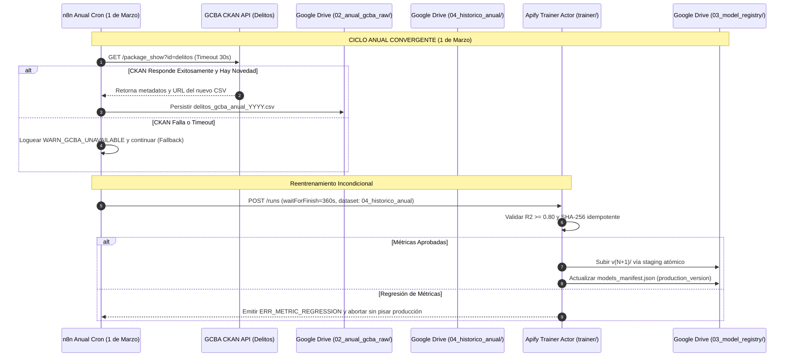

# annual-pipeline-mlops Specification

## Purpose
Define el contrato de resiliencia del pipeline anual convergente de MLOps en n8n, la política de almacenamiento dual (buffer operativo mensual vs. acumulador anual inmutable deduplicado), la carga dinámica de modelos desde Google Drive y las salvaguardas de frontera ante fallos de dependencias urbanas.

## Architecture & Lifecycle

## Requirements

### Requirement: Convergent Annual Pipeline with Graceful Fallback
The annual orchestration workflow in n8n SHALL execute on March 1st and precede model retraining with a GCBA open data audit, degrading gracefully if the external CKAN API is unreachable without blocking model retraining.

#### Scenario: Successful GCBA audit and annual retraining
- **WHEN** el cron anual se ejecuta y la API CKAN de GCBA devuelve metadatos con `hasUpdate: true`
- **THEN** n8n descarga el archivo raw a `02_anual_gcba_raw/`, regenera el geo-caché de delitos y procede a invocar el Actor `trainer/` en Apify con `waitForFinish=360`.

#### Scenario: CKAN API outage with graceful fallback
- **WHEN** la API CKAN de GCBA responde con error HTTP 5xx o timeout superior a 30 segundos
- **THEN** n8n emite el token canónico `WARN_GCBA_UNAVAILABLE`, conserva el árbol de delitos vigente y procede a invocar el Actor `trainer/` sin abortar el ciclo anual.

### Requirement: Dual Storage and Natural Key Deduplication
The system SHALL maintain a dual storage architecture in Google Drive, separating the monthly 90-day dashboard buffer (`01_mensual_enriquecido/`) from an immutable 12-month annual training accumulator (`04_historico_alquileres_anual/`) deduplicated by natural key.

#### Scenario: Appending monthly listings to annual training accumulator
- **WHEN** el pipeline mensual finaliza la inferencia de un nuevo lote de publicaciones
- **THEN** n8n deposita el dataset en `01_mensual_enriquecido/` (sujeto a purga de 3 meses) y añade los registros al archivo anual en `04_historico_alquileres_anual/`, deduplicando por la clave natural `(calle_normalizada, m2_cubiertos, ambientes)` y conservando la última observación.

#### Scenario: Enforcing sufficient training volume guard
- **WHEN** el Actor Trainer recibe el dataset anual y el conteo de observaciones deduplicadas es inferior a 500 registros
- **THEN** el sistema emite la excepción canónica `ERR_INSUFFICIENT_DATA` y detiene la ejecución sin generar un artefacto incompleto.

### Requirement: Schema Guard and Bounding Box Validation on Urban Data
The ingestion process for external GCBA datasets SHALL validate coordinate bounds and column schemas before regenerating spatial indexing trees.

#### Scenario: Rejecting invalid coordinates or projection drift
- **WHEN** el dataset descargado de delitos contiene coordenadas fuera del rango canónico de CABA (latitud fuera de `[-34.705, -34.525]` o longitud fuera de `[-58.535, -58.345]`)
- **THEN** el procesador emite `ERR_SCHEMA_DRIFT`, aborta la sobrescritura de `delitos_tree.joblib` y conserva la versión previa en producción.

### Requirement: Idempotent Registry and Atomic Model Upload
The training actor SHALL compute a SHA-256 hash of the input training dataset and perform atomic multi-part uploads to Google Drive, preventing duplicated version bumps and partial artifact states.

#### Scenario: Preventing duplicate bumps on identical dataset
- **WHEN** el Actor Trainer se ejecuta con un dataset cuyo hash SHA-256 coincide exactamente con el registrado en `models_manifest.json`
- **THEN** emite el token `SKIP_IDENTICAL_DATASET` y finaliza con Exit Code 0 sin crear una carpeta `v(N+1)`.

#### Scenario: Atomic version staging on Google Drive
- **WHEN** un modelo recién entrenado supera $R^2 \ge 0.80$
- **THEN** el exportador sube `kmeans_model.joblib`, `xgb_price_model.joblib` y `model_metadata.joblib` al directorio temporal `staging_v(N+1)/`, verifica integridad y renombra a `v(N+1)/` antes de actualizar `models_manifest.json`.

## Test Plan & Resilience Strategy
- **Prueba Negativa de Fallback CKAN**: Mock de endpoint CKAN con error HTTP 504 Gateway Timeout; verificar que n8n continúe hacia el nodo de reentrenamiento.
- **Prueba de Invariantes Semánticas en n8n**: Test pytest determinista en `tests/test_n8n_workflows.py` que compruebe la presencia del nodo Trainer con `waitForFinish=360`, el token `WARN_GCBA_UNAVAILABLE` y la carpeta `04_historico_alquileres_anual`.
- **Prueba de Idempotencia por Hash**: Test unitario que pase el mismo DataFrame dos veces consecutivas a `mlops/registry.py` y verifique que no se incremente la versión.
