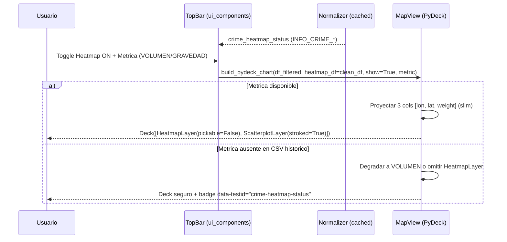

## Purpose

Proveer una capa WebGL toggleable de mapa de calor delictivo (por volumen y gravedad ponderada) en el dashboard cartográfico de CABA con payload mínimo y degradación elegante, junto con la exportación de gravedad delictiva en el Actor y un notebook ejecutivo autocontenido que sintetice el análisis end-to-end del proyecto.

---

## Test Plan & Resilience Strategy

Escenarios negativos y de frontera priorizados antes de la implementación:
1. **CSV histórico sin `indice_gravedad_delitos_500m`:** El normalizador MUST degradar al estado `INFO_CRIME_GRAVITY_UNAVAILABLE` sin lanzar excepción; el toggle opera con `VOLUMEN` y bloquea/fallback `GRAVEDAD`.
2. **CSV sin columnas de delitos (`densidad_delitos_500m` e `indice_gravedad_delitos_500m` ausentes):** El normalizador MUST emitir `INFO_CRIME_HEATMAP_UNAVAILABLE` y el dashboard MUST deshabilitar el toggle sin afectar `ScatterplotLayer`.
3. **Pesos degenerados (todos `0.0`, `NaN` o negativos):** La normalización p95 MUST evitar división por cero (`p95 <= 0`) devolviendo `0.0` determinista y acotado a `[0.0, 1.0]`.
4. **Payload y rendimiento WebGL:** Con toggle `False`, la lista de capas MUST tener longitud `1` (`ScatterplotLayer`) con `0 KB` de overhead. Con toggle `True`, la capa `HeatmapLayer` MUST recibir exactamente `3` columnas (`longitud`, `latitud`, columna de peso) produciendo un JSON de capa `<= 250 KB` para `964` filas.
5. **Preservación de selección interactiva:** `HeatmapLayer` MUST ubicarse debajo de `ScatterplotLayer` con `pickable=False` para no interceptar `pydeck_event.selection["indices"]["ScatterplotLayer"]`.
6. **Reproducibilidad del Notebook Showcase:** El `.ipynb` MUST ejecutarse de principio a fin con `Exit Code 0` sin dependencias fuera del entorno base y contener outputs renderizados verificables en disco.

---

## Diagrama de Interacción (Tier M)

---

## Requirements

### Requirement: Exportación de índice de gravedad delictiva en el Actor
El pipeline de enriquecimiento del Actor (`actor/src/pipeline.py`) MUST calcular y exportar la columna numérica `indice_gravedad_delitos_500m` junto con `densidad_delitos_500m`, reutilizando el radio de `500 m` y los pesos `peso_gravedad` del índice espacial precargado.

#### Scenario: Enriquecimiento exitoso con volumen y gravedad delictiva
- **GIVEN** un lote válido de propiedades dentro del bounding box de CABA y `delitos_tree.joblib` con claves `tree`, `cantidad` y `peso_gravedad`
- **WHEN** se ejecuta la curación y enriquecimiento geoespacial del Actor
- **THEN** el DataFrame resultante MUST contener la columna `indice_gravedad_delitos_500m` con dtype flotante, `0` valores `NaN`, y todos los valores `>= 0.0`

#### Scenario: Propiedad sin delitos en radio de 500 m
- **GIVEN** una propiedad cuyas coordenadas no tienen vecinos en `del_bundle["tree"]` dentro de `500 m`
- **WHEN** se calcula `indice_gravedad_delitos_500m`
- **THEN** el valor asignado MUST ser exactamente `0.0` sin lanzar `IndexError` ni `ValueError`

---

### Requirement: Pre-cálculo y degradación elegante de pesos delictivos en el Normalizador
El normalizador del dashboard (`dashboard/src/normalizer.py`) MUST pre-calcular pesos normalizados `[0.0, 1.0]` recortados en el percentil 95 (`crime_weight_vol` y `crime_weight_grav`) dentro de la ruta cacheada y reportar explícitamente el estado de disponibilidad mediante tokens canónicos en `meta["crime_heatmap_status"]`.

#### Scenario: Dataset completo con volumen y gravedad disponibles
- **GIVEN** un DataFrame válido con las columnas `densidad_delitos_500m` e `indice_gravedad_delitos_500m` con valores positivos
- **WHEN** se invoca `normalize_schema(df)`
- **THEN** `meta["crime_heatmap_status"]` MUST ser exactamente `"INFO_CRIME_FULL_AVAILABLE"`, `meta["available_crime_metrics"]` MUST ser `["VOLUMEN", "GRAVEDAD"]`, y las columnas `crime_weight_vol` y `crime_weight_grav` MUST tener todos sus valores finitos dentro de `[0.0, 1.0]` con al menos el 5% superior saturado en `1.0`

#### Scenario: CSV histórico sin columna de gravedad delictiva
- **GIVEN** un DataFrame válido que contiene `densidad_delitos_500m` pero omite `indice_gravedad_delitos_500m`
- **WHEN** se invoca `normalize_schema(df)`
- **THEN** `meta["crime_heatmap_status"]` MUST ser exactamente `"INFO_CRIME_GRAVITY_UNAVAILABLE"`, `meta["available_crime_metrics"]` MUST ser `["VOLUMEN"]`, y `crime_weight_vol` MUST permanecer en `[0.0, 1.0]` sin lanzar excepciones

#### Scenario: Dataset sin ninguna columna de delitos
- **GIVEN** un DataFrame válido que omite tanto `densidad_delitos_500m` como `indice_gravedad_delitos_500m`
- **WHEN** se invoca `normalize_schema(df)`
- **THEN** `meta["crime_heatmap_status"]` MUST ser exactamente `"INFO_CRIME_HEATMAP_UNAVAILABLE"` y `meta["available_crime_metrics"]` MUST ser `[]`

#### Scenario: Valores delictivos todos en cero o NaN (protección división por cero)
- **GIVEN** un DataFrame válido donde `densidad_delitos_500m` contiene únicamente `0.0` y `NaN`
- **WHEN** se invoca `normalize_schema(df)`
- **THEN** la columna `crime_weight_vol` MUST contener únicamente `0.0` (`0` valores `NaN` o `inf`) y `meta["status"]` MUST ser `"SCHEMA_VALID"`

---

### Requirement: Capa WebGL HeatmapLayer toggleable con proyección slim y contraste preservado
El motor de mapa (`dashboard/src/map_view.py`) y la barra superior (`dashboard/src/ui_components.py`, `dashboard/app.py`) MUST ofrecer un toggle en la barra superior apagado por defecto, renderizar la capa `HeatmapLayer` en escala de rojos con proyección slim de 3 columnas desde `clean_df` (estable frente a filtros), y preservar la legibilidad y selección de `ScatterplotLayer`.

#### Scenario: Estado inicial con toggle apagado (cero overhead)
- **GIVEN** un DataFrame normalizado de propiedades válidas
- **WHEN** se construye el mapa con `show_crime_heatmap=False` (valor por defecto)
- **THEN** `deck.layers` MUST contener exactamente `1` capa de tipo `"ScatterplotLayer"` y `0` capas de tipo `"HeatmapLayer"`

#### Scenario: Toggle encendido con proyección slim y orden de capas
- **GIVEN** un DataFrame filtrado `df_filtered` (10 filas) y un DataFrame completo `clean_df` (964 filas) con `crime_weight_vol` y `crime_weight_grav`
- **WHEN** se construye el mapa con `show_crime_heatmap=True`, `crime_metric="VOLUMEN"` y `heatmap_df=clean_df`
- **THEN** `deck.layers` MUST contener exactamente `2` capas en orden `[HeatmapLayer, ScatterplotLayer]`; la capa `HeatmapLayer` MUST tener `pickable == False`, exactamente `3` columnas en su DataFrame de datos, `964` filas (no filtradas), escala `color_range` creciente hacia rojo intenso (`R >= 160` en el tramo superior), y el `ScatterplotLayer` MUST mantener `id == "ScatterplotLayer"`, `pickable == True` y `stroked == True`

#### Scenario: Solicitud de métrica GRAVEDAD sobre CSV histórico sin gravedad
- **GIVEN** un DataFrame normalizado con `crime_weight_vol` presente pero sin `crime_weight_grav`
- **WHEN** se construye el mapa con `show_crime_heatmap=True` y `crime_metric="GRAVEDAD"`
- **THEN** el motor MUST degradar automáticamente al peso `crime_weight_vol` sin lanzar `KeyError` y retornar un `pdk.Deck` válido con `2` capas

#### Scenario: Controles visibles y leyenda de calor en la interfaz superior
- **GIVEN** la aplicación Streamlit cargada con un dataset que posee métricas delictivas
- **WHEN** el usuario activa el control de mapa de calor en la barra superior
- **THEN** la interfaz MUST renderizar el selector de métrica (`Volumen` / `Gravedad`) y la leyenda cromática con atributo `data-testid="crime-heatmap-legend"`

---

### Requirement: Notebook Ejecutivo End-to-End de Muestra (Showcase B1)
El repositorio MUST incluir un notebook Jupyter autocontenido en `notebooks/observatorio_caba_showcase.ipynb` que sintetice la documentación del proyecto (`Q1`–`Q5`, ETL, EDA/H1–H6, VIF, K-Means, XGBoost + TreeSHAP nativo vía `pred_contribs=True`, simulación de ahorro RR.HH. y MLOps Registry `v1`) utilizando exclusivamente librerías ya instaladas en el entorno.

#### Scenario: Estructura completa, ejecución determinista y cero dependencias nuevas
- **GIVEN** los datasets curados y artefactos del repositorio (`etl/output/dataset_enriquecido_completo.csv`, `Datasets/Curados/delitos_2022_curado.csv`, `mlops/resultados_inferencia_caba.csv`, `mlops/artifacts/v1/`, `mlops/registry.json`)
- **WHEN** se valida y ejecuta `notebooks/observatorio_caba_showcase.ipynb` en un entorno sin `plotly`, `folium`, `shap` ni `statsmodels`
- **THEN** todas las celdas de código MUST finalizar con `Exit Code 0`, el archivo `.ipynb` MUST ser JSON válido con al menos `6` gráficos embebidos (`image/png` en `outputs`), y MUST cubrir explícitamente las 5 preguntas de negocio (`Q1` a `Q5`), las pruebas de hipótesis (`H1` a `H6`), el análisis espacial de delitos (volumen y gravedad), K-Means, XGBoost + TreeSHAP nativo y el resumen del Model Registry `v1`
