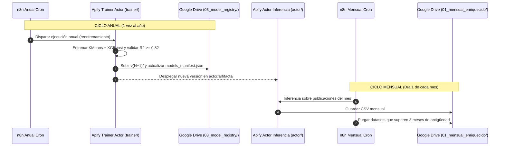

# mlops-annual-training Specification

## Purpose
Define el contrato del Actor de entrenamiento anual serverless en Apify, la jerarquía de versionado de modelos en Google Drive (03_model_registry) y la política de retención trimestral en n8n.

## Architecture & Lifecycle

## Requirements

### Requirement: Incremental Model Versioning and Registry
The system MUST provide an incremental model registry that bumps model version (`v1`, `v2`, `v3`) upon training and validates that metric degradation does not exceed defined thresholds.

#### Scenario: Running model training bump
- **WHEN** el script de entrenamiento se ejecuta con el argumento `--bump`
- **THEN** se crea un nuevo subdirectorio `mlops/artifacts/v(N+1)/` conteniendo `kmeans_model.joblib`, `xgb_price_model.joblib` y `model_metadata.joblib`, y se actualiza `mlops/registry.json` con las métricas obtenidas.

#### Scenario: Preventing regression on training
- **WHEN** un nuevo modelo entrenado produce un coeficiente $R^2$ inferior al umbral mínimo de 0.80
- **THEN** el sistema emite una excepción canónica `ERR_METRIC_REGRESSION`, aborta la actualización del puntero de producción y no reemplaza los artefactos vigentes.

### Requirement: Serverless Apify Training Actor
The system MUST provide a standalone serverless Apify actor (`trainer/`) capable of executing on-demand model retraining, exporting serialized binaries to Google Drive in `03_model_registry/`.

#### Scenario: Executing training actor in Apify
- **WHEN** el actor de entrenamiento recibe el payload de ejecución anual
- **THEN** ejecuta el pipeline de modelado en su contenedor Docker, sube la nueva versión a la carpeta `03_model_registry/v(N)/` en Google Drive y actualiza el archivo `models_manifest.json` en Drive con Exit Code 0.

### Requirement: Monthly Dataset Retention Policy in n8n
The system MUST enforce a 3-month retention policy for monthly enriched CSV datasets deposited in the `01_mensual_enriquecido` Google Drive directory.

#### Scenario: Purging obsolete monthly datasets
- **WHEN** el workflow mensual en n8n finaliza la subida de un nuevo archivo CSV
- **THEN** busca todos los archivos en la carpeta `01_mensual_enriquecido`, conserva únicamente los 3 más recientes según fecha de creación, y envía los excedentes a la papelera de Google Drive.

## Test Plan & Resilience Strategy
- **Verificación de Registry**: Test unitario que valida que `mlops/registry.json` mantenga el schema esperado (`production_version`, `history`, `metrics`).
- **Verificación de Aislamiento**: Verificar que el actor de entrenamiento en `trainer/` no comparta dependencias en tiempo de ejecución con el actor mensual en `actor/`.
